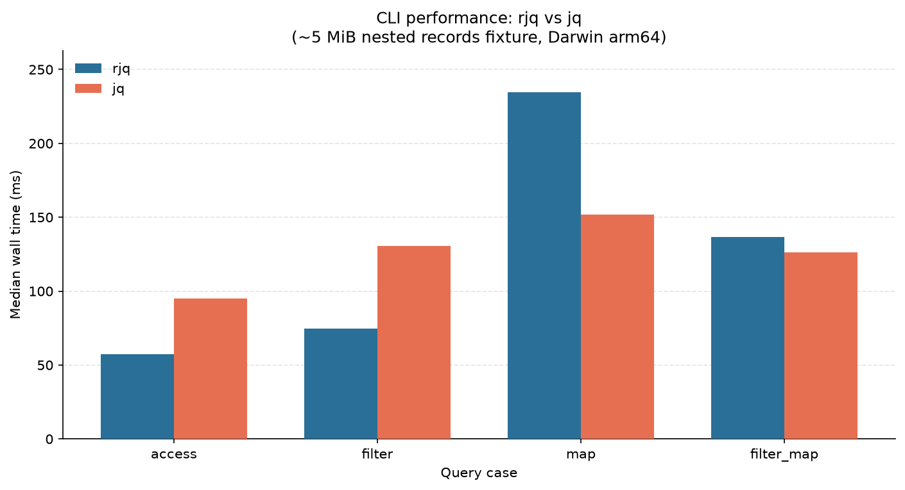

# rs-jq

Learning project: JSON parser + jq-like query language, written in Rust.

Still early / WIP. APIs and behavior will change.

## What's here

- `src/json` — JSON lexer & parser
- `src/jql` — query language (lexer, parser, engine)
- `src/bin/jq` — CLI binary (optional, feature `cli`)

## Build

```bash
cargo build
```

CLI:

```bash
cargo build --features cli
```

## Test

```bash
cargo test
```

## Benchmarks

JQL query benchmarks (access / filter / map / filter_map on nested records) live under [`benchmark/`](benchmark/README.md):

| Suite | What |
|---|---|
| **rust** | In-process `jql_execute` (parse once) |
| **cli** | `rjq` vs stock `jq` (process wall time) |

```bash
cargo build --release --features cli --bin rjq --bin bench-jql

python benchmark/run.py                  # rust + cli (~5 MiB fixture)
python benchmark/run.py --suite rust
python benchmark/run.py --suite cli
```

### CLI: rjq vs jq

Median wall time on a ~5 MiB nested-records fixture (Darwin arm64, 5 timed runs):



| Case | rjq | jq | Relative |
|---|---:|---:|---|
| access | 57.3 ms | 95.2 ms | rjq **1.66×** faster |
| filter | 74.4 ms | 130.7 ms | rjq **1.76×** faster |
| map | 234.6 ms | 152.0 ms | jq **1.54×** faster |
| filter_map | 136.6 ms | 126.1 ms | jq **1.08×** faster |

## Optimization methods

- **`Cow` for strings (and numbers)** — JSON strings without escapes and number spellings borrow the input buffer (`Cow::Borrowed`); only unescape / `into_owned` allocate. Avoids copying every scalar into a new `String` during lex/parse.
- **Builder straight to the target type** — `JsonBuilder` separates syntax (parser) from representation. Native path builds `JsonValue`; Python path (`PyBuilder`) emits `PyDict` / `PyList` / scalars directly — no intermediate `JsonValue` tree on the `rjson` hot path.
- **Lazy number parse** — lexer keeps the raw digit span (`JsonNumber` + `IntegerLike` / `FloatLike`). Parse to `i64` / `f64` (or Python `int` / `float` / big `int`) only when a consumer needs a numeric value; `json_dump` can rewrite the original spelling.
- **SIMD + NEON** — vectorized scans for string specials and non-whitespace: AVX2 on `x86_64`, NEON on Apple Silicon / `aarch64`, with scalar fallback elsewhere.
- **Pull bytes from lexer & parser** — cursor walks the input byte slice in place (`SliceCursor` / remaining window); tokens and values borrow spans instead of accumulating a separate owned buffer of characters as the primary representation.

## Notable JQL queries

Queries below run against the fixture `src/jql/sample.json`.

### Access

```text
.                              # whole document
.count                         # 42
.jobs[1]                       # second job
.jobs[0,2]                     # pick indices
.jobs[1:3]                     # slice [start:end)
.jobs[]                        # all items (identity on array)
.person{name,age}              # project object keys
.jobs[]{title,description}     # project keys on each item
.company.teams[0].name         # "platform"
.matrix[0][1]                  # nested index → 2
.nested[1][1][0]               # deep nest → 3
```

### Pipe

```text
.matrix[0] | .[1]                              # 2
.company | .teams[1] | .name                   # "data"
.jobs | .[0].title                             # "Dev"
.matrix[1] | .[0,2]                            # [4, 6]
.count | . > 40                                # true
.jobs[0].title | . == "Dev"                    # true
```

### Filter

```text
.jobs | filter(.active == true)
.jobs | filter(.id > 2)
.people | filter(.vip == true && .score >= 70)
.candidates | filter(.id > 10 && .age < 20 && (.money > 10 || .gold >= 1))
.jobs | filter((.level == "senior" || .level == "mid") && .money >= 50)
```

### Map

```text
.jobs | map(.title)
.jobs | filter(.active == true) | map(.id)
.matrix | map(.[0])
.jobs | filter(.id > 2) | map({ name: .title, pay: .money })
.company.teams | map({ name: .name, size: .size })
```

### Compose

```text
.jobs[]{title,id} | filter(.id > 2) | .[0].title
.company.teams | filter(.size > 5) | .[0].name
.jobs[0,3] | filter(.active == true) | .[1].title
.people | filter(.vip == true) | .[0].name
.matrix | filter(.[0] > 3) | .[0].[1]
.jobs | filter(.active == true) | map(.title)
```
