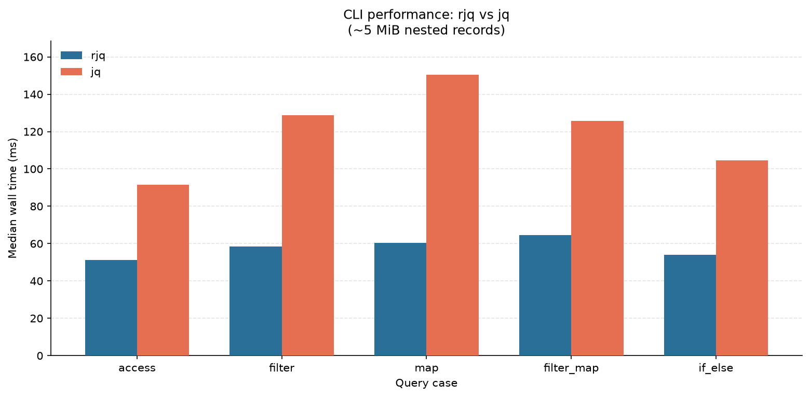

# rjq

Learning project: JSON parser + jq-like query language, written in Rust.

Median wall time on a ~5 MiB JSON.



```
case             rjq ms      jq ms         relative
----------------------------------------------------
access            51.30      91.63 rjq 1.79x faster
filter            58.50     128.83 rjq 2.20x faster
map               60.26     150.45 rjq 2.50x faster
filter_map        64.50     125.59 rjq 1.95x faster
if_else           54.06     104.57 rjq 1.93x faster
```
**Optimization methods**

- **`Cow` for strings (and numbers)** — JSON strings without escapes and number spellings borrow the input buffer (`Cow::Borrowed`); only unescape / `into_owned` allocate. Avoids copying every scalar into a new `String` during lex/parse.
- **JQL `Proxy` lazy materialize** — engine intermediates are `Borrowed` / `Shared(Rc)` / `Owned` instead of deep-cloning between ops. Access and element iteration stay zero-copy on the input document; fan-out (`binary` / `object`) shares owned trees; new arrays/objects allocate only when the op builds a new shape; `into_owned` stays at CLI / `'static` boundaries.
- **Builder straight to the target type** — `JsonBuilder` separates syntax (parser) from representation. Native path builds `JsonValue`; Python path (`PyBuilder`) emits `PyDict` / `PyList` / scalars directly — no intermediate `JsonValue` tree on the `rjson` hot path.
- **Lazy number parse** — lexer keeps the raw digit span (`JsonNumber` + `IntegerLike` / `FloatLike`). Parse to `i64` / `f64` (or Python `int` / `float` / big `int`) only when a consumer needs a numeric value; `json_dump` can rewrite the original spelling.
- **SIMD + NEON** — vectorized scans for string specials and non-whitespace: AVX2 on `x86_64`, NEON on Apple Silicon / `aarch64`, with scalar fallback elsewhere.

## Build

```bash
cargo build
```

CLI:

```bash
cargo build --release --features cli --bin rjq
```

## JQL syntax

```text
.                              # identity
.count                         # property
.jobs[1]                       # index
.jobs[0,2]                     # multi-index
.jobs[1:3]                     # slice [start:end)
.jobs[]                        # all elements
.person{name,age}              # project keys
."kebab-case" / .["x-y"]       # quoted / bracket key
._id / .person{_id,0,"a-b"}    # underscore / digit / quoted projection
.company.teams[0].name         # chain
.matrix[0] | .[1]              # pipe
.count > 40                    # comparison
.a && .b || .c                 # logical
1 + 2 * 3                      # arithmetic
{ name: .title, pay: .money }  # object construct
```

## JQL functions

Nullary functions act on the current value (e.g. `.jobs | len`). One-arg forms take a single expression.

| Name | Args | Example |
|------|------|---------|
| `filter` | `pred` | `.jobs \| filter(.active == true)` |
| `map` | `expr` | `.jobs \| map(.title)` |
| `any` | `pred` | `.jobs \| any(.active == true)` |
| `all` | `pred` | `.jobs \| all(.id > 0)` |
| `find` | `pred` | `.jobs \| find(.id == 3)` |
| `has` | `key` | `.person \| has("age")` |
| `contains` | `value` | `.name \| contains("lic")` |
| `join` | `sep` | `.jobs \| map(.title) \| join(",")` |
| `split` | `sep` | `"a,b" \| split(",")` |
| `startswith` | `prefix` | `.title \| startswith("D")` |
| `endswith` | `suffix` | `.title \| endswith("A")` |
| `len` | — | `.jobs \| len` |
| `sum` | — | `.matrix[0] \| sum` |
| `avg` | — | `.matrix[0] \| avg` |
| `min` | — | `.matrix[0] \| min` |
| `max` | — | `.matrix[0] \| max` |
| `first` | — | `.jobs \| first` |
| `last` | — | `.jobs \| last` |
| `keys` | — | `.person \| keys` |
| `values` | — | `.person \| values` |
| `type` | — | `.jobs \| type` |
| `reverse` | — | `.matrix[0] \| reverse` |
| `flatten` | — | `.nested \| flatten` |
| `unique` | — | `.tags \| unique` |
| `sort` | — | `.scores \| sort` |
| `not` | — | `.flag \| not` |
| `abs` | — | `.delta \| abs` |
| `empty` | — | `.jobs \| empty` |

## Colored output

Syntax highlighting adapts to the terminal (`NO_COLOR`, `FORCE_COLOR`, `COLORTERM`, `TERM`). Disable with `--no-color`.

Override colors via a one-line `RJQ_COLORS` scheme (`role=#RRGGBB`, comma-separated). Roles: `key`, `string`, `number`, `boolean`, `null`, `punct`. Omit a role to keep the default. Unset / invalid → built-in default (VS Code Dark+).

```bash
export RJQ_COLORS='key=#569CD6,string=#CE9178,number=#B5CEA8,boolean=#569CD6,null=#808080,punct=#D4D4D4'
```

Popular schemes (copy into `~/.bashrc` / `~/.zshrc` / direnv):

| Theme | `RJQ_COLORS` |
|---|---|
| **VS Code Dark+** (default) | `key=#569CD6,string=#CE9178,number=#B5CEA8,boolean=#569CD6,null=#808080,punct=#D4D4D4` |
| **Dracula** | `key=#8BE9FD,string=#F1FA8C,number=#BD93F9,boolean=#FF79C6,null=#6272A4,punct=#F8F8F2` |
| **Nord** | `key=#81A1C1,string=#A3BE8C,number=#B48EAD,boolean=#EBCB8B,null=#4C566A,punct=#D8DEE9` |
| **Solarized Dark** | `key=#268BD2,string=#2AA198,number=#D33682,boolean=#B58900,null=#586E75,punct=#839496` |
| **Monokai** | `key=#F92672,string=#E6DB74,number=#AE81FF,boolean=#AE81FF,null=#75715E,punct=#F8F8F2` |
| **Gruvbox Dark** | `key=#83A598,string=#B8BB26,number=#D3869B,boolean=#FABD2F,null=#928374,punct=#EBDBB2` |
| **Catppuccin Mocha** | `key=#89B4FA,string=#A6E3A1,number=#FAB387,boolean=#CBA6F7,null=#6C7086,punct=#CDD6F4` |
| **One Dark** | `key=#E06C75,string=#98C379,number=#D19A66,boolean=#56B6C2,null=#5C6370,punct=#ABB2BF` |
| **Tokyo Night** | `key=#7AA2F7,string=#9ECE6A,number=#FF9E64,boolean=#BB9AF7,null=#565F89,punct=#A9B1D6` |

```bash
# example: Nord for this shell
export RJQ_COLORS='key=#81A1C1,string=#A3BE8C,number=#B48EAD,boolean=#EBCB8B,null=#4C566A,punct=#D8DEE9'
rjq -i data.json -s '.jobs[]'
rjq --no-color -i data.json   # plain output
```
